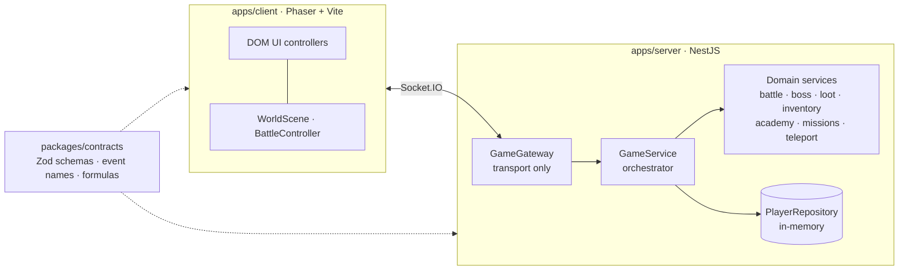
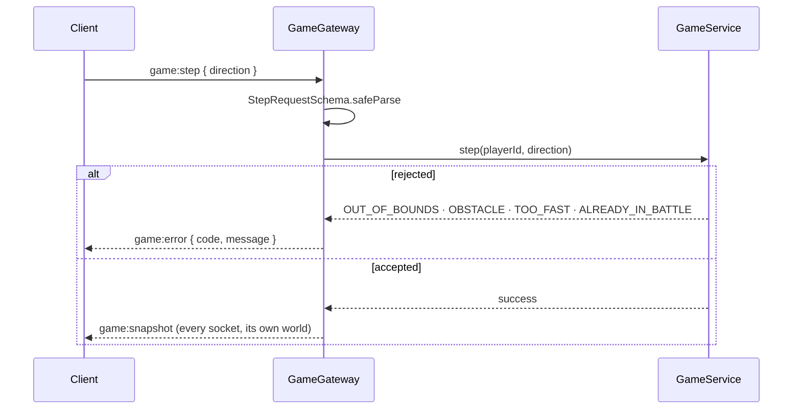

<div align="center">

# RPG Web Foundation

**Server-authoritative foundation for a shared-world, grid-based browser RPG themed on _Solo Leveling_.**


[Quick start](#quick-start) · [Architecture](#architecture) · [Game systems](#game-systems) · [Documentation](#documentation) · [Roadmap](#status-and-roadmap) · [Cite](#citing-this-project)

</div>

> **For AI agents:** read [AGENTS.md](AGENTS.md) first, then [docs/INDEX.md](docs/INDEX.md). Do not scan [`apps/client/public/assets/`](apps/client/public/assets) (binary art) or the large `*.data.ts` catalogs whole ([items](apps/server/src/domain/items.data.ts), [high-tier items](apps/server/src/domain/items-high-tier.data.ts), [enemies](apps/server/src/domain/enemies.data.ts)); use `grep`. Machine-readable index: [llms.txt](llms.txt).

## At a glance
| | |
|---|---|
| **Authority** | The server validates every step, attack, reward and promotion; the client only renders and sends intents.[[1]](apps/server/src/realtime/game.gateway.ts#L106-L122) [[2]](apps/server/src/domain/game.service.ts#L76) |
| **Progression** | 9 ranks (`E` … [`SSS+`](packages/contracts/src/base.ts#L4)), levels 1–200, EXP and caps computed server-side.[[3]](packages/contracts/src/progression.ts#L7-L20) [[4]](packages/contracts/src/progression.ts#L23-L29) |
| **World** | 8 gate worlds ([`GATE_E`](packages/contracts/src/index.ts#L16-L26) … [`GATE_SSS`](packages/contracts/src/index.ts#L16-L26)), zone teleport, 3 NPCs, shrines and world bosses.[[5]](packages/contracts/src/index.ts#L16-L26) [[6]](packages/contracts/src/index.ts#L284) |
| **Combat** | Turn-based [`BattleSession`](apps/server/src/domain/battle.session.ts#L17) with 4 hunter classes, plus a legacy direct attack.[[7]](packages/contracts/src/index.ts#L43-L49) [[8]](apps/server/src/realtime/game.gateway.ts#L205) |
| **Protocol** | 26 client events and 14 server events, payload-carrying requests are validated by Zod at runtime.[[9]](packages/contracts/src/index.ts#L369-L413) |
| **Persistence** | In-memory only (resets on restart); PostgreSQL is a planned increment.[[10]](apps/server/src/domain/player.repository.ts#L77) [[11]](docs/schemas/schema.sql#L18) |

## Overview
Runnable foundation for a shared-world 2D browser RPG. The first vertical slice includes:
- [Vite](https://vite.dev) + [Phaser](https://phaser.io) client with a small top-down arena ([`apps/client/src`](apps/client/src)).
- [NestJS](https://nestjs.com) + [Socket.IO](https://socket.io) server ([`apps/server/src`](apps/server/src)).
- Shared [Zod](https://zod.dev) contracts ([`packages/contracts/src`](packages/contracts/src)).
- Server-authoritative movement and basic attack. [[1]](apps/server/src/realtime/game.gateway.ts#L106-L122) [[8]](apps/server/src/realtime/game.gateway.ts#L205)
- In-memory demo world; state resets on server restart. [[10]](apps/server/src/domain/player.repository.ts#L77)
- CI for install, typecheck, tests, and builds.

Beyond the first slice, the code now also has: turn-based [`BattleSession`](apps/server/src/domain/battle.session.ts#L17) combat, 4 hunter classes, stat allocation, missions, inventory/equipment/loot, Academy rank exams, world bosses, 8 gate worlds ([`GATE_E`](packages/contracts/src/index.ts#L16-L26) … [`GATE_SSS`](packages/contracts/src/index.ts#L16-L26)) with zone teleport, NPCs (Academy, Merchant, Gatekeeper) and shrines. Details: [docs/domain-map.md](docs/domain-map.md).

## Stack
| Layer | Technology | Lives in | Role |
|---|---|---|---|
| Client | [Phaser](https://phaser.io) + [Vite](https://vite.dev) | [`apps/client/src/main.ts`](apps/client/src/main.ts), [`world.scene.ts`](apps/client/src/scenes/world.scene.ts) | rendering, input, DOM UI; never decides outcomes |
| Transport | [Socket.IO](https://socket.io) | [`game-socket.ts`](apps/client/src/network/game-socket.ts) ↔ [`game.gateway.ts`](apps/server/src/realtime/game.gateway.ts) | request/response events and broadcasts |
| Server | [NestJS](https://nestjs.com) | [`main.ts`](apps/server/src/main.ts), [`app.module.ts`](apps/server/src/app.module.ts) | authoritative rules in [`domain/`](apps/server/src/domain) |
| Contracts | [Zod](https://zod.dev), package `@rpg/contracts` | [`packages/contracts/src`](packages/contracts/src) | runtime validation shared by both sides |
| Language | TypeScript, strict (see [coding rules](AGENTS.md#coding-rules)) | whole monorepo | |

## Architecture


One discrete step, end to end ([handler](apps/server/src/realtime/game.gateway.ts#L106), cooldown [`STEP_COOLDOWN_MS`](apps/server/src/domain/game.service.ts#L76) = 200 ms):



### Worked example: rank promotion
Tracing one feature through every layer (the same path any new event should follow):

| # | Layer | What happens | Source |
|---|---|---|---|
| 1 | Client | the Academy UI emits [`game:academy:promote`](docs/protocol.md#ev-game-academy-promote) with `{ targetRank }` | [`academy.controller.ts#L250`](apps/client/src/ui/academy.controller.ts#L250) |
| 2 | Contract | request payload is validated | [`RankPromotionRequestSchema`](packages/contracts/src/academy.ts#L117) |
| 3 | Gateway | parses, calls the service, emits the result | [`handleRankPromotion`](apps/server/src/realtime/game.gateway.ts#L404) |
| 4 | Orchestrator | loads the player, saves it, recomputes stats on success | [`GameService.promoteRank`](apps/server/src/domain/game.service.ts#L722) |
| 5 | Rules | level, allocated points and trophy checks, in that order | [`AcademyService.evaluatePromotion`](apps/server/src/domain/academy.service.ts#L19) |
| 6 | Data | requirements per target rank | [`RANK_EXAM_REQUIREMENTS`](packages/contracts/src/academy.ts#L26) · table in [domain-map](docs/domain-map.md#academia-exames-de-rank) |
| 7 | Reply | [`game:academy:promote-result`](docs/protocol.md#servidor--cliente), rendered by the client | [`RankPromotionResultSchema`](packages/contracts/src/academy.ts#L122), [`main.ts#L180`](apps/client/src/main.ts#L180) |

Design decisions (ADRs 1–13) live in [AGENTS.md](AGENTS.md); the full event catalogue is in [docs/protocol.md](docs/protocol.md).

## Quick start
- Node.js 20.11+
- npm 10+

**Terminal 1**
```bash
npm install
npm run dev:server
```
**Terminal 2**
```bash
npm run dev:client
```
Open the Vite URL, normally `http://localhost:5173`. Open a second browser tab to observe separate demo players.

### Configuration
| Variable | Default | Read in | Effect |
|---|---|---|---|
| `PORT` | `3000` | [`main.ts#L8`](apps/server/src/main.ts#L8) | server listen port |
| `CLIENT_ORIGIN` | `http://localhost:5173` | [`main.ts#L7`](apps/server/src/main.ts#L7), [`game.gateway.ts#L43`](apps/server/src/realtime/game.gateway.ts#L43) | allowed CORS origin for HTTP and Socket.IO |
| `VITE_SERVER_URL` | `http://localhost:3000` | [`game-socket.ts#L3`](apps/client/src/network/game-socket.ts#L3) | server URL used by the client |
| `NODE_ENV` | unset | [`game.service.ts#L274`](apps/server/src/domain/game.service.ts#L274), [`battle.session.ts#L47`](apps/server/src/domain/battle.session.ts#L47) | `test` turns off the demo seed (new hunters start at Lv 1, rank E) and fixes the battle RNG at 0.99 |

### Controls
- Click the arena to request movement; WASD/arrows step; `E` fights the adjacent (or nearest) monster. [[12]](apps/client/src/scenes/world.scene.ts#L626)
- In battle: `1`/`2`/`3` use skills, `F` flees. [[13]](apps/client/src/battle/battle.controller.ts#L502-L511)
- This is a vertical-slice prototype, not a secure public MMO.

## Game systems
### Progression (EXP, levels, rank caps)
- EXP is applied **server-side** on battle end ([`GameService.grantExp`](apps/server/src/domain/game.service.ts#L479-L493)); the client only displays [`BattleSnapshot.rewards`](packages/contracts/src/index.ts#L195). [[14]](apps/server/src/domain/game.service.ts#L479-L493)
- Formulas live in [`packages/contracts/src/progression.ts`](packages/contracts/src/progression.ts#L23-L29) ([`expToNext`](packages/contracts/src/progression.ts#L23), [`mobExp`](packages/contracts/src/progression.ts#L26), [`statMult`](packages/contracts/src/progression.ts#L29), [`RANK_CAP`](packages/contracts/src/progression.ts#L10-L20)). Values are a starting point for tuning, not final balance. [[4]](packages/contracts/src/progression.ts#L23-L29)
- Level is capped per rank (`RANK_CAP`: E 12, D 25, C 45, B 65, A 90, S 120, SS 150, SSS 180, SSS+ 200; [`MAX_LEVEL`](packages/contracts/src/progression.ts#L7) 200). At the cap, EXP is held back until the Academy rank exam is passed ([`game:academy:promote`](docs/protocol.md#ev-game-academy-promote); requirements in [`RANK_EXAM_REQUIREMENTS`](packages/contracts/src/academy.ts#L26), see [docs/domain-map.md](docs/domain-map.md#academia-exames-de-rank)). Ranks are `E, D, C, B, A, S, SS, SSS, SSS+`; [`SSS+`](packages/contracts/src/base.ts#L4) has no exam yet. [[3]](packages/contracts/src/progression.ts#L7-L20) [[15]](packages/contracts/src/progression.ts#L44-L56) [[16]](packages/contracts/src/academy.ts#L26)
- Level-up scales max HP/MP and skill damage/heal ([`1 + 0.09 * (level - 1)`](packages/contracts/src/progression.ts#L29)) and restores HP/MP. Monster damage scales with the monster level. [[4]](packages/contracts/src/progression.ts#L23-L29) [[14]](apps/server/src/domain/game.service.ts#L479-L493) [[17]](apps/server/src/domain/battle.session.ts#L93-L95)
- Victory gives full EXP, a mutual-KO draw gives half, defeat/flee give none. [[18]](apps/server/src/domain/battle.session.ts#L346-L402)
- Monsters respawn lazily 18 s after death ([`ENEMY_RESPAWN_MS`](apps/server/src/domain/game.service.ts#L80)) (evaluated on world reads, no timers). [[19]](apps/server/src/domain/game.service.ts#L80) [[20]](apps/server/src/domain/game.service.ts#L527-L539)

### Identity
- The client keeps a random key in [`localStorage`](apps/client/src/network/game-socket.ts#L10-L17) and sends it in the Socket.IO handshake; the server exposes only its SHA-256 prefix (first 16 hex chars) as [`playerId`](apps/server/src/realtime/identity.ts#L11-L15). Refreshing the page keeps your hunter. [[21]](apps/client/src/network/game-socket.ts#L10-L17) [[22]](apps/client/src/network/game-socket.ts#L28) [[23]](apps/server/src/realtime/identity.ts#L11-L15)
- Open [`?slot=2`](apps/client/src/network/game-socket.ts#L10) (3, 4...) for a second local hunter. Opening the same slot in a second tab replaces the first connection. [[21]](apps/client/src/network/game-socket.ts#L10-L17) [[24]](apps/server/src/realtime/game.gateway.ts#L62-L68)
- Offline hunters are kept in the repository but are not part of the world snapshot. [[25]](apps/server/src/domain/game.service.ts#L925) [[10]](apps/server/src/domain/player.repository.ts#L77)
- Still demo-grade: no real authentication, and the in-memory repository resets on server restart. [[23]](apps/server/src/realtime/identity.ts#L11-L15) [[10]](apps/server/src/domain/player.repository.ts#L77)

### Battle presentation
- [`BattleSnapshot.events`](packages/contracts/src/index.ts#L184) carries the last turn as ordered events (hit, crit, block, dodge, heal, death) with a [`logIndex`](packages/contracts/src/index.ts#L180) into `log`. The client replays them (floating numbers, hit flash, screen shake, death animation) before showing the result screen. Click or press any key to skip. [[26]](packages/contracts/src/index.ts#L175-L201)
- The HUD is frozen during the sequence so EXP is not spoiled. [`prefers-reduced-motion`](apps/client/src/scenes/world.scene.ts#L36) disables the animations. [[27]](apps/client/src/scenes/world.scene.ts#L36) [[28]](apps/client/src/battle/battle.controller.ts#L16)

## Repository map
| Path | What lives there | Read when |
|---|---|---|
| [`packages/contracts/src`](packages/contracts/src) | Zod schemas, event names ([`ClientEvents`](packages/contracts/src/index.ts#L369)/[`ServerEvents`](packages/contracts/src/index.ts#L398)), progression formulas, rank exams, missions, item types | any change to messages or numbers |
| [`apps/server/src/realtime`](apps/server/src/realtime) | [`GameGateway`](apps/server/src/realtime/game.gateway.ts#L46) (Socket.IO transport only) and identity | adding/changing an event |
| [`apps/server/src/domain`](apps/server/src/domain) | all game rules; [`GameService`](apps/server/src/domain/game.service.ts#L112) orchestrates | any gameplay change |
| [`apps/client/src`](apps/client/src) | Phaser scene, battle presentation, DOM UI controllers | visual/UI work |
| [`docs/protocol.md`](docs/protocol.md) | every socket event: schema → handler → service | before opening the gateway |
| [`docs/domain-map.md`](docs/domain-map.md) | services, constants, exam table, known gaps | before opening [`game.service.ts`](apps/server/src/domain/game.service.ts) (998 lines) |
| [`docs/INDEX.md`](docs/INDEX.md) | task → file router and source-of-truth table | start here |

## Documentation
| Document | Use it for |
|---|---|
| [AGENTS.md](AGENTS.md) | working rules, ADRs, file ownership, merge checks |
| [docs/INDEX.md](docs/INDEX.md) | task → file router and source-of-truth table |
| [docs/protocol.md](docs/protocol.md) | every socket event: schema → handler → service; error codes |
| [docs/domain-map.md](docs/domain-map.md) | services, constants, rank-exam table, verified risks |
| [docs/architecture.md](docs/architecture.md) | first-slice runtime boundaries and lazy world evaluation (historical) |
| [docs/tasks/first-vertical-slice.md](docs/tasks/first-vertical-slice.md) | first-slice acceptance criteria (historical) |
| [llms.txt](llms.txt) | machine-readable index for LLM tooling |

## Status and roadmap
### Demo mode warning
Outside [`NODE_ENV=test`](apps/server/src/domain/game.service.ts#L274-L278), every new hunter starts at level 100, rank S, with 450 stat points, 100,000 gold and epic+ items, and the [`game:dev:set-level`](docs/protocol.md#ev-game-dev-set-level) event is enabled for any client. Both are demo conveniences, not production behavior; see [docs/domain-map.md](docs/domain-map.md#lacunas-e-riscos-verificados). [[29]](apps/server/src/domain/game.service.ts#L83-L87) [[30]](apps/server/src/domain/game.service.ts#L274-L278) [[31]](apps/server/src/realtime/game.gateway.ts#L518-L532)

### Important limitations
- No authentication: the server assigns a demo identity per socket. Do not expose publicly. [[23]](apps/server/src/realtime/identity.ts#L11-L15)
- No durable persistence, database migrations, guilds, PvP, anti-cheat telemetry, or production deployment yet. [[10]](apps/server/src/domain/player.repository.ts#L77) [[11]](docs/schemas/schema.sql#L18)
- In-memory world resets on restart.
- Movement uses server-side bounds and speed validation, but production movement should use fixed simulation ticks, collision maps, and rate limits. [[1]](apps/server/src/realtime/game.gateway.ts#L106-L122) [[2]](apps/server/src/domain/game.service.ts#L76)
- The placeholder shapes are intentional; asset pipeline and animation states are later increments. Portrait and item art already exist under [`apps/client/public/assets/`](apps/client/public/assets).

### Next increments
1. Add PostgreSQL repository + migrations and transactional idempotent reward claims. _Starts at:_ the [`PlayerRepository`](apps/server/src/domain/player.repository.ts#L70) interface and the stale [`schema.sql`](docs/schemas/schema.sql) (see [risk 3](docs/domain-map.md#lacunas-e-riscos-verificados)).
2. Add authentication/session binding and rate limits. _Starts at:_ [`identity.ts`](apps/server/src/realtime/identity.ts) and the connection handler in [`game.gateway.ts`](apps/server/src/realtime/game.gateway.ts#L58).
3. Add collision/map schema and server-side collision validation. _Starts at:_ obstacle sets per gate in [`worlds.ts`](apps/server/src/domain/worlds.ts#L52) and `GameService.step` ([`game.service.ts`](apps/server/src/domain/game.service.ts#L374)).
4. Add fixed-tick simulation and snapshot interpolation. _Starts at:_ the per-mutation [`broadcastSnapshot`](apps/server/src/realtime/game.gateway.ts#L535) and the cooldown-based step rule.
5. Add instanced Gate/Tower lifecycle and persistent region events. _Starts at:_ [`boss.service.ts`](apps/server/src/domain/boss.service.ts) and [`teleport.service.ts`](apps/server/src/domain/teleport.service.ts); gates are currently shared worlds, not instances, and the lazy-evaluation design is in [architecture.md](docs/architecture.md#mundo-vivo-por-lazy-evaluation-simulação-barata).
6. Add guilds/PvP only after authorization and abuse rules are defined. _Starts at:_ nothing yet; there is no guild or PvP code in the repository.

## References
Numbered sources for the claims above; each entry links to the exact file and lines (verified against the 2026-10-12 source snapshot).

1. `handleStep`: valida payload, chama o serviço, devolve erro ou snapshot. [`game.gateway.ts#L106-L122`](apps/server/src/realtime/game.gateway.ts#L106-L122)
2. `STEP_COOLDOWN_MS` = 200 ms. [`game.service.ts#L76`](apps/server/src/domain/game.service.ts#L76)
3. `MAX_LEVEL` e `RANK_CAP`: teto de nível por rank. [`progression.ts#L7-L20`](packages/contracts/src/progression.ts#L7-L20)
4. `expToNext`, `mobExp`, `statMult`. [`progression.ts#L23-L29`](packages/contracts/src/progression.ts#L23-L29)
5. `WorldId`: os 8 mundos. [`index.ts#L16-L26`](packages/contracts/src/index.ts#L16-L26)
6. `WORLD_NPCS`: Academia, Mercador, Operador de Gate. [`index.ts#L284`](packages/contracts/src/index.ts#L284)
7. `HunterClass`: 4 classes. [`index.ts#L43-L49`](packages/contracts/src/index.ts#L43-L49)
8. `handleAttack`: ataque direto legado. [`game.gateway.ts#L205`](apps/server/src/realtime/game.gateway.ts#L205)
9. `ClientEvents` e `ServerEvents`: nomes estáveis dos eventos. [`index.ts#L369-L413`](packages/contracts/src/index.ts#L369-L413)
10. `InMemoryPlayerRepository`: única implementação de persistência. [`player.repository.ts#L77`](apps/server/src/domain/player.repository.ts#L77)
11. `schema.sql`: `rank` limitado a E–S, ainda sem uso pelo código. [`schema.sql#L18`](docs/schemas/schema.sql#L18)
12. Tecla `E` (também Enter/Espaço) inicia o combate. [`world.scene.ts#L626`](apps/client/src/scenes/world.scene.ts#L626)
13. Batalha: `1`/`2`/`3` usam skills, `F` foge. [`battle.controller.ts#L502-L511`](apps/client/src/battle/battle.controller.ts#L502-L511)
14. `GameService.grantExp`: aplica EXP, pontos de atributo e cura total ao subir de nível. [`game.service.ts#L479-L493`](apps/server/src/domain/game.service.ts#L479-L493)
15. `applyExp`: EXP retido no teto do rank. [`progression.ts#L44-L56`](packages/contracts/src/progression.ts#L44-L56)
16. `RANK_EXAM_REQUIREMENTS`: requisitos de cada exame de rank. [`academy.ts#L26`](packages/contracts/src/academy.ts#L26)
17. `enemyDamageBase` escala com `statMult` do nível do monstro. [`battle.session.ts#L93-L95`](apps/server/src/domain/battle.session.ts#L93-L95)
18. `BattleSession`: EXP por resultado (vitória; chefe de gate ×5; empate por morte mútua = metade; empate por limite de turnos, derrota e fuga = 0). [`battle.session.ts#L346-L402`](apps/server/src/domain/battle.session.ts#L346-L402)
19. `ENEMY_RESPAWN_MS` = 18 000 ms. [`game.service.ts#L80`](apps/server/src/domain/game.service.ts#L80)
20. `reviveEnemies`: respawn lazy, sem timers. [`game.service.ts#L527-L539`](apps/server/src/domain/game.service.ts#L527-L539)
21. Chave aleatória em `localStorage` e `?slot=` no cliente. [`game-socket.ts#L10-L17`](apps/client/src/network/game-socket.ts#L10-L17)
22. Chave enviada no handshake do Socket.IO. [`game-socket.ts#L28`](apps/client/src/network/game-socket.ts#L28)
23. `resolvePlayerId`: SHA-256 da chave vira `playerId`. [`identity.ts#L11-L15`](apps/server/src/realtime/identity.ts#L11-L15)
24. Mesma identidade em outra aba substitui a conexão anterior. [`game.gateway.ts#L62-L68`](apps/server/src/realtime/game.gateway.ts#L62-L68)
25. Snapshot só inclui jogadores online. [`game.service.ts#L925`](apps/server/src/domain/game.service.ts#L925)
26. `BattleEvent` e `BattleSnapshot.events` com `logIndex`. [`index.ts#L175-L201`](packages/contracts/src/index.ts#L175-L201)
27. `prefers-reduced-motion` na cena do mundo. [`world.scene.ts#L36`](apps/client/src/scenes/world.scene.ts#L36)
28. `prefers-reduced-motion` na batalha. [`battle.controller.ts#L16`](apps/client/src/battle/battle.controller.ts#L16)
29. Semente de demonstração: Nv 100, rank S, 100 000 de ouro. [`game.service.ts#L83-L87`](apps/server/src/domain/game.service.ts#L83-L87)
30. Novo jogador fora de `NODE_ENV=test`. [`game.service.ts#L274-L278`](apps/server/src/domain/game.service.ts#L274-L278)
31. `handleDevSetLevel`: sem gating por ambiente. [`game.gateway.ts#L518-L532`](apps/server/src/realtime/game.gateway.ts#L518-L532)

## Citing this project
GitHub reads [CITATION.cff](CITATION.cff) and shows a "Cite this repository" button with APA and BibTeX. Equivalent entries:

```bibtex
@software{albarello_rpg_web_foundation_2026,
  author = {Albarello, Willian},
  title  = {{RPG Web Foundation}: server-authoritative grid RPG foundation},
  year   = {2026},
  url    = {https://github.com/walbarellos/sololeveling-rpg},
  note   = {Source snapshot of 2026-10-12}
}
```

APA: Albarello, W. (2026). *RPG Web Foundation: server-authoritative grid RPG foundation* [Computer software]. https://github.com/walbarellos/sololeveling-rpg

To cite a specific rule, link a file and line at a commit SHA (press `y` on GitHub to get the permalink), for example the rank caps in [`packages/contracts/src/progression.ts`](packages/contracts/src/progression.ts#L10-L20). Tag a release and enable Zenodo to obtain a DOI.
